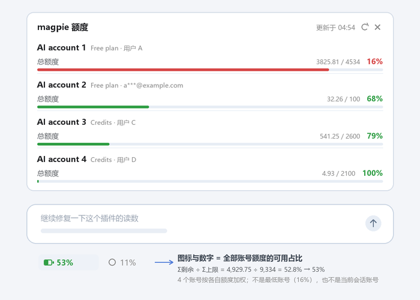

# Magpie quota · dsh-magpie-quota

A DeepSeek Harness (DSH) plugin that shows each magpie account's quota in the composer's status row, and opens a call-out panel styled like DSH's native popovers to show the details.

> Repository: https://github.com/Canvai1337/dsh-magpie-quota · 中文: [README.md](README.md)

Above: each account inside the panel still shows its **own** total-quota remaining percentage (16% / 68% / 79% / 100%), while the small battery plus number in the status row shows the **pooled usable share of all accounts — 53%** (`Σ remaining 4929.75 ÷ Σ limit 9334 = 52.81%`).

## Features

- **Status-row reading**: a battery glyph plus the **usable share of the whole account pool** — every non-expired account's remaining total-quota amount summed and divided by those accounts' limits (`Σ remaining / Σ limit`), so each account is weighted by its own quota size. It is not the lowest single account and not the current session's account. The color reflects that share (≥50% green, 20–50% yellow, <20% red) and the battery fill always matches the number.
- **Call-out panel**: click the reading to open it. Each account (`plan · user/masked alias`) shows **only two rows**:
  - **Total quota**: the account's "Total" window — the **used / limit amount**, remaining percentage, and a usage bar;
  - **Model usage limit**: the account's single model-dimension window (e.g. `xxx tokens (est.)`) — the **used / limit amount**, remaining percentage, and a usage bar; **omitted when the account has no such window**;
  - other credit sub-buckets (Credits / Extra credits, …) are intentionally not listed.
- **Data source**: the Host half requests `GET {baseUrl}/v1/magpie/quotas` server-side; the browser only makes a same-origin request to `/__local/magpie-quota`, so the gateway's lack of CORS headers does not matter.
- **Refresh**: a single page-wide store — many composers share one data snapshot and one 60s poll, with deduplicated requests. It refreshes on mount, on open, on tab visibility / window focus, and shows a "may be stale" dot if a refresh fails while old data is shown.
- **Expired accounts**: an account whose `until` is past is marked "Expired", dimmed, and excluded from the summary reading (it contributes to neither the numerator nor the denominator).
- **Errors**: timeout / unreachable / gateway errors are shown as localized messages; the Host never echoes upstream bodies or internal addresses.

## Usage

1. Install and enable the plugin (Profiles → Plugins).
2. Make sure magpie is running; its gateway defaults to `http://127.0.0.1:3425`.
3. Open any session — the reading appears in the status row below the composer; click it to inspect.

## Configuration

Editable under the plugin row's `config` in `cordis.patch.yml`:

| Field | Default | Meaning |
|---|---|---|
| `baseUrl` | `http://127.0.0.1:3425` | magpie gateway root; the plugin appends `/v1/magpie/quotas`. |
| `timeoutMs` | `8000` | Server-side read timeout in milliseconds (500–60000). |

## Implementation & performance

- **Client** (`client.js`): one module-level store + `useSyncExternalStore`, so N composers share a single request; one 60s poller; scroll/resize repositioning coalesced with `requestAnimationFrame`; the stylesheet is injected into `document.head` once.
- **Host** (`index.js`): a trusted same-origin route fetches the gateway and passes through `{ data, fetchedAt }`; errors return only a stable `code`.
- **UI**: uses DSH theme tokens (`--dsw-alias-*`) and adapts to light/dark automatically; the panel's surface, radius, type scale, and dismiss behavior match the native "context usage" popover.

## Limitations

- Only reads magpie's `/v1/magpie/quotas`; accounts it does not return are not shown.
- Each account shows just its total quota and one model usage limit; if several model limits exist, only one (preferring token/model names) is shown.
- Read-only display: no top-up, switching, or routing actions.
- If the gateway is unreachable the panel shows an error with Retry and the reading shows "—".

## License

[MIT](LICENSE) © 2026 Canvai1337
