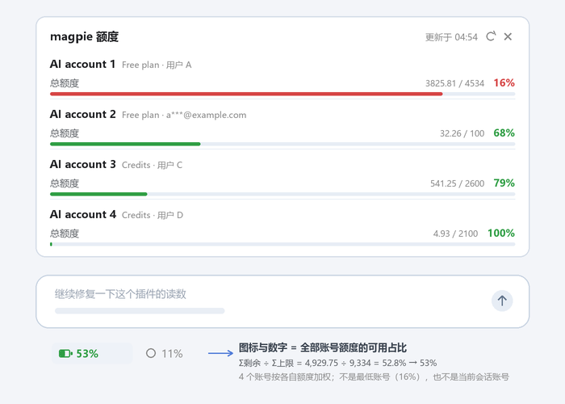

# magpie 额度 · dsh-magpie-quota

DeepSeek Harness（DSH）插件：在输入框下方的状态行显示本机 **magpie 网关**各账号的额度读数；点击读数呼出一个与 DSH 原生呼出窗口风格一致的弹层查看明细。

> 仓库：https://github.com/Canvai1337/dsh-magpie-quota · English: [README.en.md](README.en.md)

上图：弹层里每个账号仍显示「各自总额度」的剩余占比（16% / 68% / 79% / 100%），而下方状态行的小电池 + 数字显示的是**全部账号合并后的可用占比 53%**（`Σ剩余 4929.75 ÷ Σ上限 9334 = 52.81%`）。

## 功能

- **状态行读数**：一个电池图形 + 全部账号额度中**可使用部分的占比**（把每个未过期账号「总额度」的剩余量相加、除以这些账号的上限之和；即 `Σ剩余 / Σ上限`，按各账号自身额度大小加权）。因此它表示的是整池额度的可动用比例，而非单个账号或当前会话账号的余量。颜色按该比例分档（≥50% 绿、20–50% 黄、<20% 红），电池填充宽度与数字始终一致。
- **呼出窗口**：点击读数打开，每个账号（`plan · 用户/掩码别名`）**只展示两项**：
  - **总额度**：取该账号的 “Total” 额度窗口，显示 **已用 / 上限 的积分量**、剩余占比与比例条；
  - **模型用量限制**：取该账号唯一一个模型维度的窗口（如 `xxx tokens (est.)`），显示 **已用 / 上限 的积分量**、剩余占比与比例条；**若该账号没有此类窗口，则这一项省略**；
  - 其它信用额度子桶（Credits / Extra credits 等）不再逐条列出。
- **数据来源**：Host 半在服务端请求 `GET {baseUrl}/v1/magpie/quotas`，浏览器只做同源请求 `/__local/magpie-quota`，因此不受网关 CORS 限制。
- **刷新机制**：整页仅一个共享数据仓库（store）——多输入框共用同一份数据与同一个 60s 轮询，请求自动去重；挂载、打开窗口、标签页重新可见 / 窗口获得焦点时都会刷新；刷新失败时保留旧数据，并在读数右上角显示“可能已过期”小圆点。
- **过期账号**：`until` 已过期的账号标注「已过期」并淡化，且不计入汇总读数（其额度不计入占比的分子与分母）。
- **错误处理**：超时 / 不可达 / 网关异常分别以本地化文案提示；Host 不回传上游正文或内网地址。

## 使用

1. 安装并启用本插件（Profiles → 插件）。
2. 确保 magpie 正在运行，其网关默认在 `http://127.0.0.1:3425`。
3. 打开任意会话，输入框下方状态行即出现额度读数；点击即可查看明细。

## 配置

在 `cordis.patch.yml` 中该插件行的 `config` 里可调：

| 字段 | 默认 | 说明 |
|---|---|---|
| `baseUrl` | `http://127.0.0.1:3425` | magpie 网关根地址，插件会追加 `/v1/magpie/quotas`。 |
| `timeoutMs` | `8000` | 服务端读取额度的超时（毫秒，500–60000）。 |

## 实现与性能

- **客户端**（`client.js`）：一个模块级 store + `useSyncExternalStore`，N 个输入框共用一次请求；一个 60s 轮询；滚动/缩放时以 `requestAnimationFrame` 合并重排；样式只在 `document.head` 注入一次。
- **宿主端**（`index.js`）：注册受信任的同源路由，服务端 `fetch` 网关并透传 `{ data, fetchedAt }`；错误只返回稳定 `code`。
- **界面**：沿用 DSH 主题令牌（`--dsw-alias-*`），浅/深色自动适配；弹层材质/圆角/字号/关闭行为对齐原生「上下文占用」弹层。

## 限制

- 只读取 magpie 官方额度接口 `/v1/magpie/quotas`；接口未返回的账号不会显示。
- 每个账号只展示「总额度」与「一个模型用量限制」；如有多模型额度，仅展示其中一个（按 token/model 名称优先）。
- 额度为只读展示，不提供充值、切换或路由操作。
- 若网关不可达，窗口显示错误并可「重试」，读数显示为「—」。

## 许可证

[MIT](LICENSE) © 2026 Canvai1337
