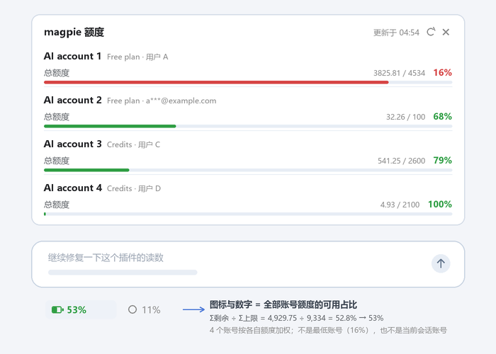

The status-row chip answers "how much of everything I have is still spendable":
Σ remaining ÷ Σ limit across every non-expired account (weighted by each
account's own quota), so it is neither the lowest single account nor the
current session's account. The panel below it keeps the per-account view.
